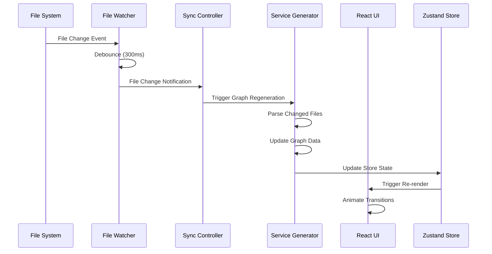
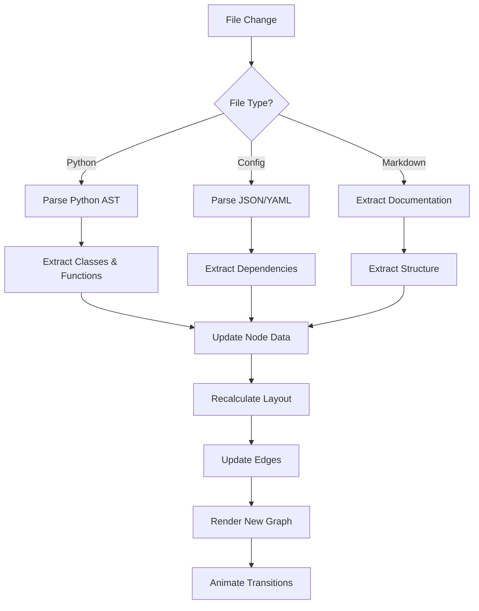

# Enterprise Agent System Visualization Platform - Technical Architecture

## 1. System Architecture Overview

### 1.1 High-Level Architecture

```
┌─────────────────────────────────────────────────────────────────┐
│                    Presentation Layer                            │
│  ┌────────────┐ ┌────────────┐ ┌────────────┐ ┌────────────┐ │
│  │  Homepage  │ │Architecture│ │  Workflows │ │ Sequences  │ │
│  └────────────┘ └────────────┘ └────────────┘ └────────────┘ │
│  ┌────────────┐ ┌────────────┐ ┌────────────┐                 │
│  │   Docs     │ │  Monitor   │ │  Search    │                 │
│  └────────────┘ └────────────┘ └────────────┘                 │
└─────────────────────────────────────────────────────────────────┘
                              │
┌─────────────────────────────────────────────────────────────────┐
│                    State Management Layer                        │
│  ┌──────────────────────┐  ┌──────────────────────────────┐    │
│  │  Zustand Store       │  │  React Query Cache           │    │
│  │  - UI State          │  │  - Graph Data                │    │
│  │  - Navigation        │  │  - Document Cache            │    │
│  │  - Theme             │  │  - Version History           │    │
│  └──────────────────────┘  └──────────────────────────────┘    │
└─────────────────────────────────────────────────────────────────┘
                              │
┌─────────────────────────────────────────────────────────────────┐
│                    Visualization Engine Layer                    │
│  ┌────────────────┐ ┌────────────────┐ ┌────────────────┐    │
│  │   Mermaid.js   │ │     D3.js       │ │  React Flow    │    │
│  │  Flowcharts    │ │  Custom Charts  │ │  Node Graphs   │    │
│  │  Sequence      │ │  Data Viz       │ │  Dependency    │    │
│  └────────────────┘ └────────────────┘ └────────────────┘    │
└─────────────────────────────────────────────────────────────────┘
                              │
┌─────────────────────────────────────────────────────────────────┐
│                    File Watcher & Sync Layer                    │
│  ┌──────────────────────┐  ┌──────────────────────────────┐    │
│  │  chokidar            │  │  WebSocket Server            │    │
│  │  File System Watch   │  │  Real-time Updates           │    │
│  └──────────────────────┘  └──────────────────────────────┘    │
└─────────────────────────────────────────────────────────────────┘
```

### 1.2 Module Architecture (Domain-Driven Design)

```
Enterprise Agent System Visualization Platform
│
├── src/
│   ├── domain/                     # Domain Layer (Core Business Logic)
│   │   ├── models/
│   │   │   ├── ArchitectureNode.ts      # Architecture node model
│   │   │   ├── WorkflowStep.ts          # Workflow step model
│   │   │   ├── SequenceDiagram.ts      # Sequence diagram model
│   │   │   └── Document.ts             # Documentation model
│   │   ├── interfaces/
│   │   │   ├── IArchitectureRepository.ts
│   │   │   ├── IWorkflowService.ts
│   │   │   └── ISequenceService.ts
│   │   └── types/
│   │       ├── architecture.types.ts
│   │       ├── workflow.types.ts
│   │       └── sequence.types.ts
│   │
│   ├── core/                       # Core Application Services
│   │   ├── services/
│   │   │   ├── ArchitectureService.ts    # Architecture graph generation
│   │   │   ├── WorkflowService.ts         # Workflow diagram generation
│   │   │   ├── SequenceService.ts         # Sequence diagram generation
│   │   │   ├── FileWatcherService.ts      # File system monitoring
│   │   │   └── SyncService.ts             # Real-time sync
│   │   ├── stores/
│   │   │   ├── architectureStore.ts      # Zustand store
│   │   │   ├── workflowStore.ts
│   │   │   ├── sequenceStore.ts
│   │   │   └── uiStore.ts
│   │   └── hooks/
│   │       ├── useArchitecture.ts
│   │       ├── useWorkflow.ts
│   │       ├── useSequence.ts
│   │       └── useFileWatcher.ts
│   │
│   ├── infrastructure/              # Infrastructure Layer (External Services)
│   │   ├── api/
│   │   │   ├── FileSystemAPI.ts          # File system operations
│   │   │   ├── GitHubAPI.ts              # GitHub integration
│   │   │   └── ExportAPI.ts              # Export functionality
│   │   ├── adapters/
│   │   │   ├── MermaidAdapter.ts         # Mermaid diagram adapter
│   │   │   ├── D3Adapter.ts              # D3 chart adapter
│   │   │   └── ReactFlowAdapter.ts       # React Flow adapter
│   │   ├── persistence/
│   │   │   ├── LocalStorageAdapter.ts    # Local storage
│   │   │   ├── IndexedDBAdapter.ts        # IndexedDB for large data
│   │   │   └── VersionHistoryAdapter.ts   # Version management
│   │   └── services/
│   │       ├── NotificationService.ts
│   │       ├── AnalyticsService.ts
│   │       └── PerformanceMonitor.ts
│   │
│   ├── presentation/                # Presentation Layer (UI Components)
│   │   ├── pages/
│   │   │   ├── HomePage.tsx
│   │   │   ├── ArchitecturePage.tsx
│   │   │   ├── WorkflowsPage.tsx
│   │   │   ├── SequencesPage.tsx
│   │   │   ├── DocsPage.tsx
│   │   │   └── MonitorPage.tsx
│   │   ├── components/
│   │   │   ├── common/
│   │   │   │   ├── Header.tsx
│   │   │   │   ├── Sidebar.tsx
│   │   │   │   ├── Footer.tsx
│   │   │   │   └── Breadcrumb.tsx
│   │   │   ├── architecture/
│   │   │   │   ├── ArchitectureGraph.tsx
│   │   │   │   ├── ModuleCard.tsx
│   │   │   │   ├── DependencyEdge.tsx
│   │   │   │   └── TechStackBadge.tsx
│   │   │   ├── workflow/
│   │   │   │   ├── WorkflowDiagram.tsx
│   │   │   │   ├── StepNode.tsx
│   │   │   │   └── DecisionBranch.tsx
│   │   │   ├── sequence/
│   │   │   │   ├── SequenceDiagram.tsx
│   │   │   │   ├── ActorNode.tsx
│   │   │   │   └── MessageArrow.tsx
│   │   │   └── charts/
│   │   │       ├── LineChart.tsx
│   │   │       ├── BarChart.tsx
│   │   │       └── PieChart.tsx
│   │   └── layouts/
│   │       ├── MainLayout.tsx
│   │       ├── DocumentationLayout.tsx
│   │       └── DashboardLayout.tsx
│   │
│   └── app/                        # Application Entry Points
│       ├── App.tsx
│       ├── routes.tsx
│       └── providers.tsx
```

## 2. Technology Stack

### 2.1 Frontend Framework
```typescript
// Core Framework
React: "^18.2.0"
React-DOM: "^18.2.0"
React-Router-DOM: "^6.20.0"

// TypeScript
TypeScript: "^5.3.0"

// Build Tool
Vite: "^5.0.0"
```

### 2.2 State Management
```typescript
// State Management
Zustand: "^4.4.0"           // Lightweight state management
React-Query: "^5.0.0"        // Server state management
React-Context: "^18.2.0"     // Theme and auth context
```

### 2.3 Visualization Libraries
```typescript
// Diagram Generation
Mermaid: "^10.6.0"           // Flowcharts and sequence diagrams

// Custom Charts
D3: "^7.8.0"                 // Data-driven documents
D3-Force: "^3.0.0"           // Force-directed graphs
D3-Scale: "^3.3.0"           // Data scales
D3-Shape: "^3.2.0"           // Shape generators
D3-Zoom: "^3.5.0"            // Zoom and pan

// Node Graphs
React-Flow: "^11.10.0"       // Node-based graphs
React-Flow-Renderer: "^11.10.0"
```

### 2.4 Styling & Animation
```typescript
// Styling
Tailwind-CSS: "^3.4.0"      // Utility-first CSS
PostCSS: "^8.4.0"            // CSS transformations
Autoprefixer: "^10.4.0"      // Vendor prefixes

// Animation
Framer-Motion: "^10.16.0"     // React animation library
Motion: "^10.16.0"           // New animation library
```

### 2.5 Development Tools
```typescript
// Linting & Formatting
ESLint: "^8.55.0"            // JavaScript linting
Prettier: "^3.1.0"           // Code formatting
Husky: "^8.0.0"              // Git hooks
Lint-Staged: "^15.2.0"       // Run linters on staged files

// Testing
Vitest: "^1.0.0"             // Unit testing
Playwright: "^1.40.0"        // E2E testing
React-Testing-Library: "^14.1.0"
```

## 3. Data Flow Architecture

### 3.1 File Change Detection Flow



### 3.2 Architecture Graph Update Flow



### 3.3 Component State Management

```typescript
// Architecture Store (Zustand)
interface ArchitectureState {
  nodes: ArchitectureNode[];
  edges: DependencyEdge[];
  selectedNode: string | null;
  zoomLevel: number;
  panPosition: { x: number; y: number };
  
  // Actions
  setNodes: (nodes: ArchitectureNode[]) => void;
  addNode: (node: ArchitectureNode) => void;
  updateNode: (id: string, updates: Partial<ArchitectureNode>) => void;
  deleteNode: (id: string) => void;
  setEdges: (edges: DependencyEdge[]) => void;
  setSelectedNode: (id: string | null) => void;
  setZoomLevel: (level: number) => void;
  setPanPosition: (position: { x: number; y: number }) => void;
}

// Workflow Store (Zustand)
interface WorkflowState {
  workflows: Workflow[];
  activeWorkflow: string | null;
  currentStep: number;
  isPlaying: boolean;
  
  // Actions
  setWorkflows: (workflows: Workflow[]) => void;
  setActiveWorkflow: (id: string) => void;
  nextStep: () => void;
  prevStep: () => void;
  play: () => void;
  pause: () => void;
  reset: () => void;
}
```

## 4. API Design

### 4.1 Internal API Services

```typescript
// File System API
class FileSystemAPI {
  // Read file content
  async readFile(path: string): Promise<string>
  
  // Watch files for changes
  watchFiles(patterns: string[], callback: FileChangeCallback): Watcher
  
  // Get file metadata
  async getFileStats(path: string): Promise<FileStats>
  
  // List directory contents
  async listDirectory(path: string): Promise<FileInfo[]>
  
  // Export to various formats
  async exportToPNG(svgElement: SVGElement): Promise<Blob>
  async exportToSVG(svgElement: SVGElement): Promise<string>
  async exportToPDF(svgElement: SVGElement): Promise<Blob>
}

// Architecture Service
class ArchitectureService {
  // Parse Python project structure
  async parseProjectStructure(rootPath: string): Promise<ProjectStructure>
  
  // Generate dependency graph
  async generateDependencyGraph(structure: ProjectStructure): Promise<DependencyGraph>
  
  // Extract module relationships
  async extractRelationships(structure: ProjectStructure): Promise<Relationship[]>
  
  // Generate architecture diagram
  async generateArchitectureDiagram(config: ArchitectureConfig): Promise<MermaidGraph>
}

// Workflow Service
class WorkflowService {
  // Define workflow from code
  async defineWorkflowFromCode(sourceCode: string): Promise<WorkflowDefinition>
  
  // Generate workflow steps
  async generateSteps(workflow: WorkflowDefinition): Promise<WorkflowStep[]>
  
  // Execute workflow simulation
  async simulateWorkflow(workflowId: string, input: any): Promise<WorkflowResult>
}

// Sequence Service
class SequenceService {
  // Parse code for sequence information
  async parseSequenceFromCode(sourceCode: string): Promise<SequenceInfo[]>
  
  // Generate sequence diagram
  async generateSequenceDiagram(sequences: SequenceInfo[]): Promise<MermaidSequence>
  
  // Add custom sequence
  async addCustomSequence(sequence: CustomSequence): Promise<void>
}
```

### 4.2 Event System

```typescript
// Custom Event Types
interface FileChangeEvent {
  type: 'create' | 'update' | 'delete';
  path: string;
  timestamp: Date;
  metadata?: {
    size?: number;
    lines?: number;
    language?: string;
  };
}

interface GraphUpdateEvent {
  type: 'node-added' | 'node-updated' | 'node-deleted' | 'edge-updated';
  nodeId?: string;
  edgeId?: string;
  data: any;
}

interface UIInteractionEvent {
  type: 'zoom' | 'pan' | 'select' | 'hover';
  target: string;
  position?: { x: number; y: number };
}

// Event Bus Implementation
class EventBus {
  private listeners: Map<string, Set<EventListener>>;
  
  on(event: string, callback: EventListener): () => void;
  off(event: string, callback: EventListener): void;
  emit(event: string, data: any): void;
  once(event: string, callback: EventListener): void;
}
```

## 5. Component Architecture

### 5.1 Architecture Graph Component

```typescript
// ArchitectureGraph.tsx
interface ArchitectureGraphProps {
  data: ArchitectureData;
  onNodeClick?: (node: ArchitectureNode) => void;
  onEdgeClick?: (edge: DependencyEdge) => void;
  zoomLevel?: number;
  panPosition?: Position;
  showMinimap?: boolean;
  showControls?: boolean;
}

// Features:
// - Zoom and pan with mouse/trackpad
// - Click to select nodes
// - Double-click to expand/collapse
// - Drag to reposition nodes
// - Hover for tooltips
// - Mini-map navigation
// - Export to PNG/SVG
```

### 5.2 Workflow Diagram Component

```typescript
// WorkflowDiagram.tsx
interface WorkflowDiagramProps {
  workflow: Workflow;
  currentStep?: number;
  isPlaying?: boolean;
  showStepNumbers?: boolean;
  orientation?: 'horizontal' | 'vertical';
  onStepClick?: (step: WorkflowStep) => void;
  onStepHover?: (step: WorkflowStep) => void;
}

// Features:
// - Step-by-step navigation
// - Play/pause animation
// - Decision branch visualization
// - Error state handling
// - Progress indicator
```

### 5.3 Sequence Diagram Component

```typescript
// SequenceDiagram.tsx
interface SequenceDiagramProps {
  sequences: SequenceInfo[];
  participants: Participant[];
  showLifelines?: boolean;
  showActivation?: boolean;
  messageAlignment?: 'left' | 'right' | 'center';
  onParticipantClick?: (participant: Participant) => void;
  onMessageClick?: (message: Message) => void;
}

// Features:
// - Auto-layout participants
// - Drag to reorder participants
// - Add custom messages
// - Highlight execution time
// - Show return values
```

## 6. Deployment Architecture

### 6.1 Build Configuration

```typescript
// vite.config.ts
import { defineConfig } from 'vite';
import react from '@vitejs/plugin-react';
import path from 'path';

export default defineConfig({
  plugins: [react()],
  resolve: {
    alias: {
      '@': path.resolve(__dirname, './src'),
      '@domain': path.resolve(__dirname, './src/domain'),
      '@core': path.resolve(__dirname, './src/core'),
      '@infrastructure': path.resolve(__dirname, './src/infrastructure'),
      '@presentation': path.resolve(__dirname, './src/presentation'),
    },
  },
  build: {
    outDir: 'dist',
    sourcemap: true,
    rollupOptions: {
      output: {
        manualChunks: {
          'vendor-react': ['react', 'react-dom'],
          'vendor-viz': ['d3', 'react-flow', 'mermaid'],
          'vendor-utils': ['zustand', 'react-query'],
        },
      },
    },
  },
  server: {
    port: 3000,
    proxy: {
      '/api': {
        target: 'http://localhost:8080',
        changeOrigin: true,
      },
    },
  },
});
```

### 6.2 Docker Configuration

```dockerfile
# Multi-stage build for optimization
FROM node:20-alpine AS builder

WORKDIR /app
COPY package*.json ./
RUN npm ci

COPY . .
RUN npm run build

# Production stage
FROM nginx:alpine AS production

COPY --from=builder /app/dist /usr/share/nginx/html
COPY nginx.conf /etc/nginx/conf.d/default.conf

EXPOSE 80
CMD ["nginx", "-g", "daemon off;"]
```

### 6.3 Environment Variables

```bash
# .env.production
VITE_APP_TITLE="Enterprise Agent System Visualization"
VITE_API_BASE_URL="/api"
VITE_FILE_WATCHER_ENABLED=true
VITE_WS_ENDPOINT="wss://api.example.com/ws"
VITE_GITHUB_TOKEN=""
VITE_GA_TRACKING_ID=""
```

## 7. Performance Optimization

### 7.1 Code Splitting Strategy

```typescript
// Lazy load pages
const HomePage = lazy(() => import('@presentation/pages/HomePage'));
const ArchitecturePage = lazy(() => import('@presentation/pages/ArchitecturePage'));
const WorkflowsPage = lazy(() => import('@presentation/pages/WorkflowsPage'));

// Lazy load heavy components
const MermaidDiagram = lazy(() => import('@infrastructure/adapters/MermaidAdapter'));
const D3Chart = lazy(() => import('@infrastructure/adapters/D3Adapter'));
```

### 7.2 Memoization Strategy

```typescript
// React.memo for pure components
const ModuleCard = React.memo(ModuleCardComponent, (prev, next) => {
  return prev.module.id === next.module.id &&
         prev.isExpanded === next.isExpanded;
});

// useMemo for expensive calculations
const graphLayout = useMemo(() => {
  return calculateGraphLayout(nodes, edges, dimensions);
}, [nodes, edges, dimensions]);

// useCallback for event handlers
const handleNodeClick = useCallback((nodeId: string) => {
  setSelectedNode(nodeId);
}, []);
```

### 7.3 Virtualization Strategy

```typescript
// For large lists
import { FixedSizeList } from 'react-window';

// Virtualize file tree
<FixedSizeList
  height={400}
  itemCount={files.length}
  itemSize={32}
  width={300}
>
  {({ index, style }) => (
    <div style={style}>
      <FileTreeItem file={files[index]} />
    </div>
  )}
</FixedSizeList>
```

## 8. Testing Strategy

### 8.1 Unit Testing (Vitest)

```typescript
// __tests__/services/ArchitectureService.test.ts
describe('ArchitectureService', () => {
  it('should parse project structure correctly', async () => {
    const service = new ArchitectureService();
    const structure = await service.parseProjectStructure('/path/to/project');
    
    expect(structure.modules).toHaveLength(5);
    expect(structure.dependencies).toHaveLength(12);
  });
  
  it('should generate valid dependency graph', async () => {
    const service = new ArchitectureService();
    const graph = await service.generateDependencyGraph(mockStructure);
    
    expect(graph.nodes).toBeDefined();
    expect(graph.edges).toBeDefined();
    expect(graph.edges.length).toBeGreaterThan(0);
  });
});
```

### 8.2 Component Testing (React Testing Library)

```typescript
// __tests__/components/ArchitectureGraph.test.tsx
describe('ArchitectureGraph', () => {
  it('should render all nodes', () => {
    render(<ArchitectureGraph data={mockData} />);
    
    const nodes = screen.getAllByRole('button', { name: /node/i });
    expect(nodes).toHaveLength(mockData.nodes.length);
  });
  
  it('should handle node click', async () => {
    const onNodeClick = jest.fn();
    render(<ArchitectureGraph data={mockData} onNodeClick={onNodeClick} />);
    
    await userEvent.click(screen.getByText('Core Layer'));
    expect(onNodeClick).toHaveBeenCalled();
  });
});
```

### 8.3 E2E Testing (Playwright)

```typescript
// e2e/architecture.spec.ts
describe('Architecture Page', () => {
  it('should load and display architecture graph', async ({ page }) => {
    await page.goto('/architecture');
    
    // Wait for graph to render
    await page.waitForSelector('[data-testid="architecture-graph"]');
    
    // Check for nodes
    const nodes = await page.locator('[data-testid="node"]').count();
    expect(nodes).toBeGreaterThan(0);
    
    // Test zoom functionality
    await page.mouse.wheel(0, -100);
    await expect(page.locator('[data-testid="zoom-level"]')).toHaveText('110%');
  });
});
```

## 9. Security Considerations

### 9.1 Input Validation

```typescript
// Sanitize file paths
const sanitizePath = (path: string): string => {
  return path.replace(/[^a-zA-Z0-9/_.-]/g, '');
};

// Validate export requests
const validateExportRequest = (request: ExportRequest): boolean => {
  return (
    request.format === 'png' ||
    request.format === 'svg' ||
    request.format === 'pdf'
  ) && request.elementId !== undefined;
};
```

### 9.2 CSP Configuration

```nginx
# nginx.conf
add_header Content-Security-Policy "
  default-src 'self';
  script-src 'self' 'unsafe-inline' 'unsafe-eval';
  style-src 'self' 'unsafe-inline' https://fonts.googleapis.com;
  font-src 'self' https://fonts.gstatic.com;
  img-src 'self' data: blob:;
  connect-src 'self' wss://api.example.com;
" always;
```

## 10. Monitoring & Analytics

### 10.1 Performance Monitoring

```typescript
// Performance Observer
const observePerformance = () => {
  const observer = new PerformanceObserver((list) => {
    list.getEntries().forEach((entry) => {
      console.log(`${entry.name}: ${entry.duration}ms`);
      
      // Send to analytics
      analytics.track('performance', {
        metric: entry.name,
        value: entry.duration,
      });
    });
  });
  
  observer.observe({ entryTypes: ['measure', 'paint'] });
};
```

### 10.2 Error Tracking

```typescript
// Global error handler
window.addEventListener('error', (event) => {
  analytics.track('error', {
    message: event.message,
    filename: event.filename,
    lineno: event.lineno,
    colno: event.colno,
  });
});

// Unhandled promise rejection
window.addEventListener('unhandledrejection', (event) => {
  analytics.track('unhandled-rejection', {
    reason: event.reason,
  });
});
```

---

**Document Version:** 1.0.0
**Creation Date:** 2026-05-15
**Last Updated:** 2026-05-15
**Author:** Agent System Development Team
**Status:** Approved for Implementation
